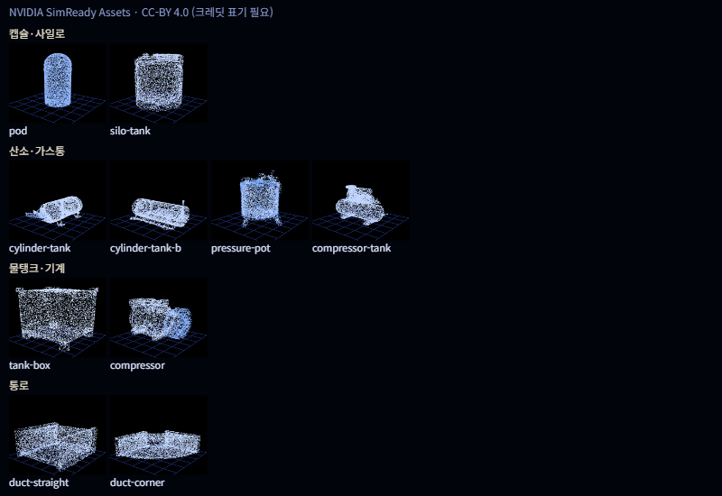
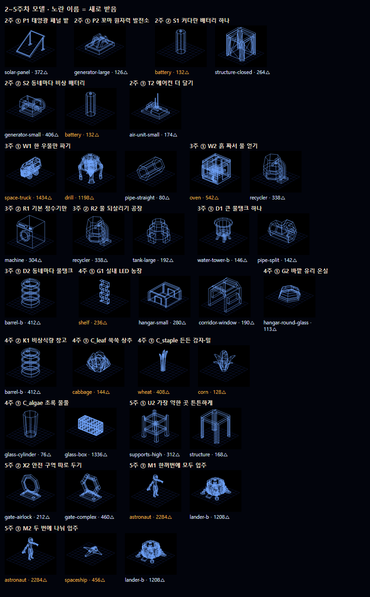

# 외부 에셋 목록

`public/models`에 넣은 외부 모델은 모두 여기에 적어 주세요. 라이선스는 CC0을 우선으로 고르고, CC-BY는 게임 크레딧에 작가 이름을 표기해야 해요.

- 정리된 파일은 `public/models/<파일명>`, 받은 원본은 `public/models/raw/<파일명>`에 같은 이름으로 있어요. 게임에는 정리된 파일을 써요.
- 새 모델을 넣으면 맞는 종류 표에 한 줄 추가하고, 미리보기 사진도 다시 만들어 주세요.
- 미리보기는 `npm run normalize:models`로 정리한 뒤 점 구름으로 그린 모습이에요 (같은 바닥, 가장 긴 변 1).

## 미리보기

## 돔

| 파일명 | 원래 이름 | 출처 URL | 작가 | 라이선스 | 쓰는 선지 |
|---|---|---|---|---|---|
| dome.glb | Geodesic Dome | https://poly.pizza/m/T7Ge6maWq4 | Quaternius | CC0 | 팽창식 모듈 |
| base-large.glb | Base Large | https://poly.pizza/m/UyH95ZAeJ2 | Quaternius | CC0 | 미정 |
| cloche.glb | Cloche | https://poly.pizza/m/Qz9XMYysBQ | MilkAndBanana | CC0 | 팽창식 모듈 |
| house-cylinder.glb | House Cylinder | https://poly.pizza/m/VQF43DYGQO | Quaternius | CC0 | 흙 3D 프린팅 집, 동굴 속 모듈, 발전소 + 비탈 마을 |

## 착륙선·기지

| 파일명 | 원래 이름 | 출처 URL | 작가 | 라이선스 | 쓰는 선지 |
|---|---|---|---|---|---|
| lander-base.glb | Space Lander Base | https://poly.pizza/m/TgOY580aMy | Kay Lousberg | CC0 | 동굴 속 모듈 |
| lander-b.glb | Lander B | https://poly.pizza/m/YPZ2B9ao7L | Kay Lousberg | CC0 | 미정 |
| cargo-depot.glb | Cargo Depot | https://poly.pizza/m/cRtW9KaGs0 | Kay Lousberg | CC0 | 얼음 옆 기지 |
| space-platform.glb | Space Platform | https://poly.pizza/m/yxbeci4pxl | Kay Lousberg | CC0 | 미정 |
| space-base-modules.glb | Space Base Modules | https://poly.pizza/m/5TxCebwK2h | Kay Lousberg | CC0 | 미정 |

## 거주 캡슐

| 파일명 | 원래 이름 | 출처 URL | 작가 | 라이선스 | 쓰는 선지 |
|---|---|---|---|---|---|
| house-long.glb | House Long | https://poly.pizza/m/X8671Q8mNc | Quaternius | CC0 | 동굴 속 모듈, 발전소 + 비탈 마을 |

## 세로로 높은 건물

| 파일명 | 원래 이름 | 출처 URL | 작가 | 라이선스 | 쓰는 선지 |
|---|---|---|---|---|---|
| silo.glb | Silo | https://poly.pizza/m/5GhLrv5Ce3 | Quaternius | CC0 | 탑형 집 |
| silo-house.glb | Silo House | https://poly.pizza/m/ZgstejsAcN | Quaternius | CC0 | 탑형 집 |
| lighthouse.glb | Light House | https://poly.pizza/m/KRebJXIRb8 | MaverickFX | CC0 | 미정 |
| tower.glb | Tower | https://poly.pizza/m/iuMDwgTRMU | Quaternius | CC0 | 미정 |

## 물탱크·물통

| 파일명 | 원래 이름 | 출처 URL | 작가 | 라이선스 | 쓰는 선지 |
|---|---|---|---|---|---|
| water-tank.glb | Water Tank | https://poly.pizza/m/XVB8vUbnZb | Quaternius | CC0 | 물 전기분해 |
| water-tank-floor.glb | Water Tank Floor | https://poly.pizza/m/xgsh3kWbAM | Quaternius | CC0 | 얼음 옆 기지, 얼음 녹여 전기분해 |
| water-tower-b.glb | Watertower | https://poly.pizza/m/WGSUkExDJ4 | Kay Lousberg | CC0 | 중앙 생산 후 관 공급 |
| barrel.glb | Barrel | https://poly.pizza/m/ONdghDBByN | Quaternius | CC0 | 미정 |
| barrel-b.glb | Barrel | https://poly.pizza/m/orjMeJQfFD | Kenney | CC0 | 미정 |
| water-bottle.glb | Water Bottle | https://poly.pizza/m/KpxDpidn1Z | Quaternius | CC0 | 미정 |
| jug.glb | Jar | https://poly.pizza/m/XGe3q5zQ5s | CreativeTrio | CC0 | 미정 |

## 산소·가스통

| 파일명 | 원래 이름 | 출처 URL | 작가 | 라이선스 | 쓰는 선지 |
|---|---|---|---|---|---|
| gas-tank.glb | Gas Tank | https://poly.pizza/m/RoCvKBGkoC | Quaternius | CC0 | 산소 탱크 비축 |
| propane-tank.glb | Propane Tank | https://poly.pizza/m/3revwBHxDC | Quaternius | CC0 | 미정 |
| pickup-tank.glb | Pickup Tank | https://poly.pizza/m/c6E9QTukqK | Quaternius | CC0 | 산소 캔들 |

## 수조·유리 통

| 파일명 | 원래 이름 | 출처 URL | 작가 | 라이선스 | 쓰는 선지 |
|---|---|---|---|---|---|
| glass-jar.glb | Pickup Jar | https://poly.pizza/m/jhvntkgHU3 | Quaternius | CC0 | 미정 |
| glass-box.glb | Container Green | https://poly.pizza/m/h5RUr3vlcS | Quaternius | CC0 | 조류 기르기 |
| glass-cylinder.glb | Glass | https://poly.pizza/m/3v7i0dz7Vg | MilkAndBanana | CC0 | 미정 |

## 기계·환풍기

| 파일명 | 원래 이름 | 출처 URL | 작가 | 라이선스 | 쓰는 선지 |
|---|---|---|---|---|---|
| machine.glb | Washing Machine | https://poly.pizza/m/UFxsKNSl8W | Quaternius | CC0 | 집마다 작은 장치 |
| machine-b.glb | Can Fridge | https://poly.pizza/m/8OHbykvREu | Quaternius | CC0 | 미정 |
| vent.glb | Vent | https://poly.pizza/m/UDFcnJ0U73 | Quaternius | CC0 | 바깥 공기 농축 |

## 통로·배관

| 파일명 | 원래 이름 | 출처 URL | 작가 | 라이선스 | 쓰는 선지 |
|---|---|---|---|---|---|
| tube-connector.glb | Connector | https://poly.pizza/m/0OKxctiaBw | Quaternius | CC0 | 팽창식 모듈 |
| pipes.glb | Pipes | https://poly.pizza/m/GB6AFkoiZb | Quaternius | CC0 | 미정 |

## 에너지·통신

| 파일명 | 원래 이름 | 출처 URL | 작가 | 라이선스 | 쓰는 선지 |
|---|---|---|---|---|---|
| solar-panel.glb | Solar Panel Ground | https://poly.pizza/m/LbGiYP5iJu | Quaternius | CC0 | 발전소 + 비탈 마을 |
| solar-panel-stand.glb | Solar Panel | https://poly.pizza/m/ah89Y79JdT | Quaternius | CC0 | 발전소 + 비탈 마을 |
| satellite-dish.glb | Satellite Dish | https://poly.pizza/m/IDRrztoAMB | Kenney | CC0 | 미정 |

## 2~5주차 추가 모델 (Poly Pizza, CC0)

2~5주차 선지에서 모자란 모델을 하나씩 받았어요. 묶음을 통째로 받지 않아서 10개를 합쳐도 약 300KB예요. 선지별 정리는 `docs/week2-5-assets.md`에 있어요.

| 파일명 | 원래 이름 | 출처 URL | 작가 | 라이선스 | 삼각형 | 쓰는 선지 |
|---|---|---|---|---|---|---|
| battery.glb | Battery | https://poly.pizza/m/MYa3uWdwPU | Quaternius | CC0 | 132 | 2주 S1 커다란 배터리, S2 동네마다 비상 배터리 |
| space-truck.glb | Space Truck | https://poly.pizza/m/HnXp3ZkfDk | Kay Lousberg | CC0 | 1,434 | 3주 W1 물 운반 (평지) |
| drill.glb | Drill | https://poly.pizza/m/8uBbH7Dvmb | Kay Lousberg | CC0 | 1,198 | 3주 W1 얼음 캐기 (능선) |
| oven.glb | Oven | https://poly.pizza/m/FGnRmwfjsT | Kay Lousberg | CC0 | 542 | 3주 W2 흙 짜서 물 얻기 |
| shelf.glb | Bookshelf | https://poly.pizza/m/30Iealxb0p | CreativeTrio | CC0 | 236 | 4주 G1 실내 LED 농장 |
| cabbage.glb | Cabbage | https://poly.pizza/m/6urnIRBhzr | Kenney | CC0 | 144 | 4주 C_leaf 쑥쑥 상추 |
| wheat.glb | Wheat | https://poly.pizza/m/lPspzfC8Pu | Quaternius | CC0 | 408 | 4주 C_staple 든든 감자·밀 |
| corn.glb | Corn | https://poly.pizza/m/NaEnzEW0JQ | Kenney | CC0 | 128 | 4주 C_staple 든든 감자·밀 |
| astronaut.glb | Astronaut | https://poly.pizza/m/4orkFqR9c9 | Polygonal Mind | CC0 | 2,284 | 5주 M1·M2 입주 |
| spaceship.glb | Spaceship | https://poly.pizza/m/H4OXkd9lWz | Quaternius | CC0 | 456 | 5주 M2 두 번에 나눠 입주 |

## NVIDIA SimReady (CC-BY 4.0)

> ⚠️ 이 표의 모델은 CC0이 아니라 **CC-BY 4.0**이에요. 게임에 쓰면 크레딧에 꼭 이렇게 적어 주세요:
> **"3D models: NVIDIA SimReady Assets (CC BY 4.0) — https://huggingface.co/datasets/nvidia/simready-assets"**

- 원본은 `.usd` 형식이라 `scripts/usd-to-glb.py`로 `.glb`로 바꾼 뒤 `npm run normalize:models`로 정리했어요.
- 바꾼 원본이 커서(최대 10MB) `raw/` 폴더에는 넣지 않았어요. 다시 만들려면 출처 URL에서 받아 변환하면 돼요.
- 원래 물건(쓰레기통, 소화 실린더 등)과 다른 이름을 붙였어요. 모양이 주거지 부품처럼 보여서 골랐어요.

| 파일명 | 원래 이름 | 출처 URL | 작가 | 라이선스 | 어울리는 쓰임 | 쓰는 선지 |
|---|---|---|---|---|---|---|
| pod.glb | trashCan_domed_blue_b01 | https://huggingface.co/datasets/nvidia/simready-assets/tree/main/trashCan_domed_blue_b01 | NVIDIA | CC-BY 4.0 | 세로형 캡슐 | 미정 |
| silo-tank.glb | serviceTool_waste_oil_tank_a01 | https://huggingface.co/datasets/nvidia/simready-assets/tree/main/serviceTool_waste_oil_tank_a01 | NVIDIA | CC-BY 4.0 | 작은 사일로 | 미정 |
| cylinder-tank.glb | fireProtection_suppressionCylinder_fixed_a01 | https://huggingface.co/datasets/nvidia/simready-assets/tree/main/fireProtection_suppressionCylinder_fixed_a01 | NVIDIA | CC-BY 4.0 | 가로형 산소통 | 미정 |
| cylinder-tank-b.glb | fireProtection_suppressionCylinder_fixed_b01 | https://huggingface.co/datasets/nvidia/simready-assets/tree/main/fireProtection_suppressionCylinder_fixed_b01 | NVIDIA | CC-BY 4.0 | 산소통 | 미정 |
| pressure-pot.glb | equipment_paintPressurePot_tank_a01 | https://huggingface.co/datasets/nvidia/simready-assets/tree/main/equipment_paintPressurePot_tank_a01 | NVIDIA | CC-BY 4.0 | 압력 탱크 | 미정 |
| compressor-tank.glb | equipment_airCompressor_a01 | https://huggingface.co/datasets/nvidia/simready-assets/tree/main/equipment_airCompressor_a01 | NVIDIA | CC-BY 4.0 | 다리 달린 가로형 탱크 | 미정 |
| tank-box.glb | ibcTank_steel_stainless_a01 | https://huggingface.co/datasets/nvidia/simready-assets/tree/main/ibcTank_steel_stainless_a01 | NVIDIA | CC-BY 4.0 | 사각 물탱크 | 미정 |
| compressor.glb | airSystem_compressor_a01 | https://huggingface.co/datasets/nvidia/simready-assets/tree/main/airSystem_compressor_a01 | NVIDIA | CC-BY 4.0 | 생명유지 기계 | 미정 |
| duct-straight.glb | hvac_vent_system_straight_a01 | https://huggingface.co/datasets/nvidia/simready-assets/tree/main/hvac_vent_system_straight_a01 | NVIDIA | CC-BY 4.0 | 곧은 통로 | 미정 |
| duct-corner.glb | hvac_vent_system_corner_a01 | https://huggingface.co/datasets/nvidia/simready-assets/tree/main/hvac_vent_system_corner_a01 | NVIDIA | CC-BY 4.0 | 꺾인 통로 | 미정 |
