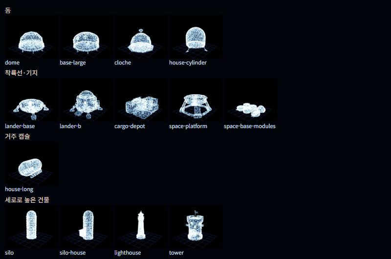
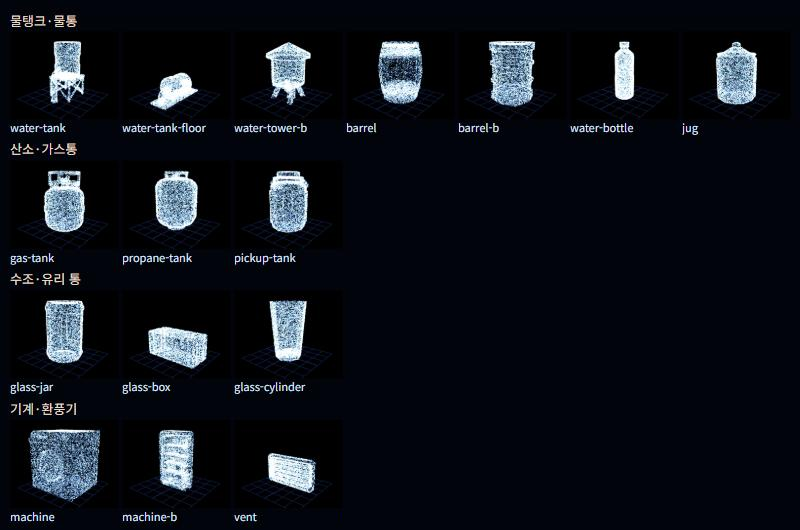
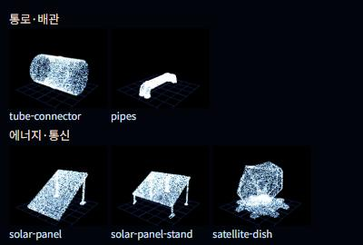

# 외부 에셋 목록

`public/models`에 넣은 외부 모델은 모두 여기에 적어 주세요. 라이선스는 CC0을 우선으로 고르고, CC-BY는 게임 크레딧에 작가 이름을 표기해야 해요.

- 정리된 파일은 `public/models/<파일명>`, 받은 원본은 `public/models/raw/<파일명>`에 같은 이름으로 있어요. 게임에는 정리된 파일을 써요.
- 새 모델을 넣으면 맞는 종류 표에 한 줄 추가하고, 미리보기 사진도 다시 만들어 주세요.
- 미리보기는 `npm run normalize:models`로 정리한 뒤 점 구름으로 그린 모습이에요 (같은 바닥, 가장 긴 변 1).

## 미리보기

## 돔

| 파일명 | 원래 이름 | 출처 URL | 작가 | 라이선스 | 쓰는 선지 |
|---|---|---|---|---|---|
| dome.glb | Geodesic Dome | https://poly.pizza/m/T7Ge6maWq4 | Quaternius | CC0 | 미정 |
| base-large.glb | Base Large | https://poly.pizza/m/UyH95ZAeJ2 | Quaternius | CC0 | 미정 |
| cloche.glb | Cloche | https://poly.pizza/m/Qz9XMYysBQ | MilkAndBanana | CC0 | 미정 |
| house-cylinder.glb | House Cylinder | https://poly.pizza/m/VQF43DYGQO | Quaternius | CC0 | 미정 |

## 착륙선·기지

| 파일명 | 원래 이름 | 출처 URL | 작가 | 라이선스 | 쓰는 선지 |
|---|---|---|---|---|---|
| lander-base.glb | Space Lander Base | https://poly.pizza/m/TgOY580aMy | Kay Lousberg | CC0 | 미정 |
| lander-b.glb | Lander B | https://poly.pizza/m/YPZ2B9ao7L | Kay Lousberg | CC0 | 미정 |
| cargo-depot.glb | Cargo Depot | https://poly.pizza/m/cRtW9KaGs0 | Kay Lousberg | CC0 | 미정 |
| space-platform.glb | Space Platform | https://poly.pizza/m/yxbeci4pxl | Kay Lousberg | CC0 | 미정 |
| space-base-modules.glb | Space Base Modules | https://poly.pizza/m/5TxCebwK2h | Kay Lousberg | CC0 | 미정 |

## 거주 캡슐

| 파일명 | 원래 이름 | 출처 URL | 작가 | 라이선스 | 쓰는 선지 |
|---|---|---|---|---|---|
| house-long.glb | House Long | https://poly.pizza/m/X8671Q8mNc | Quaternius | CC0 | 미정 |

## 세로로 높은 건물

| 파일명 | 원래 이름 | 출처 URL | 작가 | 라이선스 | 쓰는 선지 |
|---|---|---|---|---|---|
| silo.glb | Silo | https://poly.pizza/m/5GhLrv5Ce3 | Quaternius | CC0 | 미정 |
| silo-house.glb | Silo House | https://poly.pizza/m/ZgstejsAcN | Quaternius | CC0 | 미정 |
| lighthouse.glb | Light House | https://poly.pizza/m/KRebJXIRb8 | MaverickFX | CC0 | 미정 |
| tower.glb | Tower | https://poly.pizza/m/iuMDwgTRMU | Quaternius | CC0 | 미정 |

## 물탱크·물통

| 파일명 | 원래 이름 | 출처 URL | 작가 | 라이선스 | 쓰는 선지 |
|---|---|---|---|---|---|
| water-tank.glb | Water Tank | https://poly.pizza/m/XVB8vUbnZb | Quaternius | CC0 | 미정 |
| water-tank-floor.glb | Water Tank Floor | https://poly.pizza/m/xgsh3kWbAM | Quaternius | CC0 | 미정 |
| water-tower-b.glb | Watertower | https://poly.pizza/m/WGSUkExDJ4 | Kay Lousberg | CC0 | 미정 |
| barrel.glb | Barrel | https://poly.pizza/m/ONdghDBByN | Quaternius | CC0 | 미정 |
| barrel-b.glb | Barrel | https://poly.pizza/m/orjMeJQfFD | Kenney | CC0 | 미정 |
| water-bottle.glb | Water Bottle | https://poly.pizza/m/KpxDpidn1Z | Quaternius | CC0 | 미정 |
| jug.glb | Jar | https://poly.pizza/m/XGe3q5zQ5s | CreativeTrio | CC0 | 미정 |

## 산소·가스통

| 파일명 | 원래 이름 | 출처 URL | 작가 | 라이선스 | 쓰는 선지 |
|---|---|---|---|---|---|
| gas-tank.glb | Gas Tank | https://poly.pizza/m/RoCvKBGkoC | Quaternius | CC0 | 미정 |
| propane-tank.glb | Propane Tank | https://poly.pizza/m/3revwBHxDC | Quaternius | CC0 | 미정 |
| pickup-tank.glb | Pickup Tank | https://poly.pizza/m/c6E9QTukqK | Quaternius | CC0 | 미정 |

## 수조·유리 통

| 파일명 | 원래 이름 | 출처 URL | 작가 | 라이선스 | 쓰는 선지 |
|---|---|---|---|---|---|
| glass-jar.glb | Pickup Jar | https://poly.pizza/m/jhvntkgHU3 | Quaternius | CC0 | 미정 |
| glass-box.glb | Container Green | https://poly.pizza/m/h5RUr3vlcS | Quaternius | CC0 | 미정 |
| glass-cylinder.glb | Glass | https://poly.pizza/m/3v7i0dz7Vg | MilkAndBanana | CC0 | 미정 |

## 기계·환풍기

| 파일명 | 원래 이름 | 출처 URL | 작가 | 라이선스 | 쓰는 선지 |
|---|---|---|---|---|---|
| machine.glb | Washing Machine | https://poly.pizza/m/UFxsKNSl8W | Quaternius | CC0 | 미정 |
| machine-b.glb | Can Fridge | https://poly.pizza/m/8OHbykvREu | Quaternius | CC0 | 미정 |
| vent.glb | Vent | https://poly.pizza/m/UDFcnJ0U73 | Quaternius | CC0 | 미정 |

## 통로·배관

| 파일명 | 원래 이름 | 출처 URL | 작가 | 라이선스 | 쓰는 선지 |
|---|---|---|---|---|---|
| tube-connector.glb | Connector | https://poly.pizza/m/0OKxctiaBw | Quaternius | CC0 | 미정 |
| pipes.glb | Pipes | https://poly.pizza/m/GB6AFkoiZb | Quaternius | CC0 | 미정 |

## 에너지·통신

| 파일명 | 원래 이름 | 출처 URL | 작가 | 라이선스 | 쓰는 선지 |
|---|---|---|---|---|---|
| solar-panel.glb | Solar Panel Ground | https://poly.pizza/m/LbGiYP5iJu | Quaternius | CC0 | 미정 |
| solar-panel-stand.glb | Solar Panel | https://poly.pizza/m/ah89Y79JdT | Quaternius | CC0 | 미정 |
| satellite-dish.glb | Satellite Dish | https://poly.pizza/m/IDRrztoAMB | Kenney | CC0 | 미정 |
