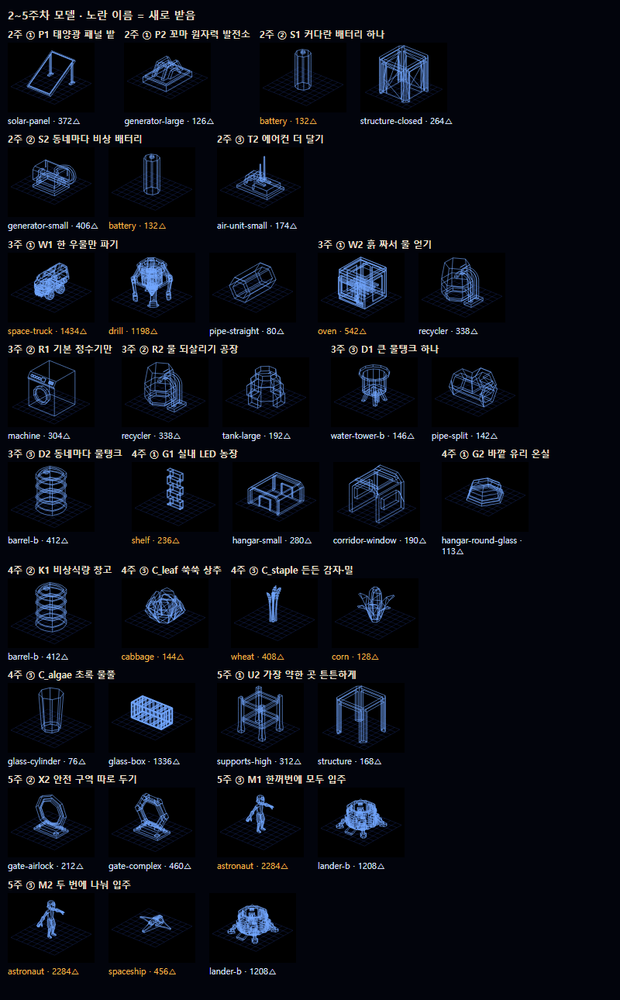

# 2~5주차 선지별 3D 에셋 정리

2~5주차 선지 데이터(2주 전기 · 3주 물 · 4주 식량 · 5주 이주 준비)를 장면 조합 규칙(`CLAUDE.md`의 "장면 = 위치 무대 + 주거 모듈 + 산소 오버레이")에 맞춰 나눴어요.

- **위치 무대**는 1주에 고른 평지·용암동굴·능선을 그대로 써요. 2~5주에는 수원(물웅덩이·얼음)처럼 땅에 붙는 것만 더해요.
- **주거 모듈**은 1주에 지은 집이에요. 2~5주에는 농장 건물처럼 집 옆에 새로 서는 건물만 더해요.
- **오버레이**는 장치(발전기·탱크·기계)와 흐름(전선·배관·물·사람 이동)이에요. 2~5주 선지는 대부분 여기에 들어가요.

## 표 읽는 법

**구하는 방법**

| 표시 | 뜻 |
|---|---|
| 있음 | 이미 받은 모델로 돼요 (`main`의 `public/models` 약 50개 + PR #25의 Kenney Space Kit 33개 + `inflatable.glb` + 이 PR에서 새로 받은 10개) |
| 코드로 만듦 | 점·기본 도형·흐름으로 직접 그려요. 모델을 찾지 않아도 돼요 |
| 새로 구함 | 팀원에게 수집을 부탁할 모델이에요 ([아래 목록](#새로-구할-모델)) |

**선 깔끔함** (와이어프레임으로 바꿀 때를 대비한 표시, 삼각형 개수 기준)

| 표시 | 삼각형 | 뜻 |
|---|---|---|
| ○ | 약 500개 이하 | 선이 깔끔해요 (Kenney Space Kit 대부분) |
| △ | 약 500~3,000개 | 조금 촘촘하지만 쓸 만해요 |
| ✕ | 약 5,000개 이상 | 선이 뭉쳐요 (NVIDIA SimReady 30~50k, `inflatable` 35k) |

> PR #25(`feat/models-week1-wire`)가 아직 `main`에 합쳐지지 않았어요. 표에서 `hangar-*`, `gate-*`, `generator-*`, `tank-large`, `recycler`, `pipe-*`, `air-unit-small`, `structure-*`, `supports-high` 등은 PR #25에 있는 모델이에요.

---

## 2주차 · 전기 만들기

| 결정 | 선지 | 장면 부분 | 구하는 방법 | 쓸 모델 / 만드는 법 | 선 |
|---|---|---|---|---|---|
| ① 전기 | P1 태양광 패널 밭 | 오버레이 (장치) | 있음 + 코드 | `solar-panel.glb` (372) 여러 장 줄 세우기, 또는 1주 `solar_village`처럼 상자 패널. 동굴(loc=B)이면 굴 밖까지 긴 전선 흐름 | ○ |
| ① 전기 | P2 꼬마 원자력 발전소 | 오버레이 (장치) | 있음 (대신) / 새로 구함 (있으면) | 지금은 `generator-large.glb` (126)로 대신. 원자로처럼 보이는 모델이 오면 교체 | ○ |
| ② 저장 | S1 커다란 배터리 하나 | 오버레이 (장치 + 흐름) | 있음 + 코드 | `battery.glb` (132)를 크게 + 받침 `structure-closed.glb` (264) + 집마다 가는 전선 흐름 (zones면 길게) | ○ |
| ② 저장 | S2 동네마다 비상 배터리 | 오버레이 (장치) | 있음 | `generator-small.glb` (406) 또는 작은 `battery.glb` (132)를 동네마다 하나씩 | ○ |
| ③ 열 | T1 거대한 방열판 | 오버레이 (장치 + 흐름) | 코드로 만듦 | 세로로 세운 얇은 상자 판 여러 장 + 밖으로 나가는 열 흐름(주황) | ○ |
| ③ 열 | T2 에어컨 더 달기 | 오버레이 (장치) | 있음 | `air-unit-small.glb` (174)를 집마다 붙이기 | ○ |

## 3주차 · 물 구하기

| 결정 | 선지 | 장면 부분 | 구하는 방법 | 쓸 모델 / 만드는 법 | 선 |
|---|---|---|---|---|---|
| ① 새 물 | W1 한 우물만 파기 (water=far) | 위치 무대 + 오버레이 | 코드 + 있음 | 멀리 있는 물웅덩이(점) + 오가는 길(흐름) + 운반차 `space-truck.glb` (1,434) | △ |
| ① 새 물 | W1 한 우물만 파기 (water=cave) | 위치 무대 + 오버레이 | 코드 + 있음 | 동굴 안 물웅덩이(점) + `pipe-straight.glb` (80) | ○ |
| ① 새 물 | W1 한 우물만 파기 (water=ice) | 위치 무대 + 오버레이 | 코드 + 있음 | 얼음판은 1주 `ice_base`처럼 점으로 + 얼음 캐는 `drill.glb` (1,198) | △ |
| ① 새 물 | W2 흙 짜서 물 얻기 | 오버레이 (장치) | 있음 + 코드 | 흙 데우는 기계로 `oven.glb` (542) + 흙에서 올라오는 물 흐름. 부엌 오븐이 어색하면 `recycler.glb` (338)로 교체 | △ |
| ② 재사용 | R1 기본 정수기만 | 오버레이 (장치) | 있음 | `machine.glb` (304) 하나 | ○ |
| ② 재사용 | R2 물 되살리기 공장 | 오버레이 (장치 + 흐름) | 있음 + 코드 | `recycler.glb` (338) + `tank-large.glb` (192), 집 → 공장 → 탱크로 돌아오는 물 흐름 | ○ |
| ③ 나누기 | D1 큰 물탱크 하나 | 오버레이 (장치 + 흐름) | 있음 + 코드 | `water-tower-b.glb` (146) + `pipe-split.glb` (142)·`pipe-straight.glb`, 집마다 가는 물 흐름 (zones/longLine이면 길게) | ○ |
| ③ 나누기 | D2 동네마다 물탱크 | 오버레이 (장치) | 있음 | `barrel-b.glb` (412)를 동네마다 + 작은 펌프 `air-unit-small.glb` | ○ |

## 4주차 · 먹을 것 만들기

| 결정 | 선지 | 장면 부분 | 구하는 방법 | 쓸 모델 / 만드는 법 | 선 |
|---|---|---|---|---|---|
| ① 농장 | G1 실내 LED 농장 | 주거 모듈 (새 건물) | 있음 + 코드 | 건물은 `hangar-small.glb` (280) 또는 `corridor-window.glb` (190), 재배 선반은 `shelf.glb` (236)를 나란히. LED 불빛은 크림색 점 | ○ |
| ① 농장 | G2 바깥 유리 온실 | 주거 모듈 (새 건물) | 있음 | `hangar-round-glass.glb` (113). 동굴(loc=B)이면 굴 밖까지 오가는 길 흐름 | ○ |
| ② 비중 | K1 비상식량 창고 채우기 | 오버레이 (장치) | 코드로 만듦 | 상자를 쌓아 만든 식량 더미 (`barrel-b.glb`를 섞어도 됨) | ○ |
| ② 비중 | K2 농장 크게 키우기 | 오버레이 (조합) | 코드로 만듦 | 고른 농장·작물을 1.5배 줄로 복제. 새 모델 필요 없음 | — |
| ③ 작물 | C_leaf 쑥쑥 상추 | 오버레이 (장치) | 있음 | `cabbage.glb` (144)를 줄 세우기 | ○ |
| ③ 작물 | C_staple 든든 감자·밀 | 오버레이 (장치) | 있음 | `wheat.glb` (408)·`corn.glb` (128)를 밭처럼 깔기. 감자 모델은 없어서 밀로 표현 | ○ |
| ③ 작물 | C_algae 초록 물풀(조류) | 오버레이 (장치 + 흐름) | 있음 + 코드 | `glass-cylinder.glb` (76) 여러 개 = 배양 통, 안에서 올라오는 공기 방울 흐름 (크림). 1주 `glass-box.glb` (1336 △)도 가능 | ○ |

## 5주차 · 이주민 맞이 준비

| 결정 | 선지 | 장면 부분 | 구하는 방법 | 쓸 모델 / 만드는 법 | 선 |
|---|---|---|---|---|---|
| ① 보강 | U1 가장 부족한 것 채우기 | 오버레이 (조합) | 코드로 만듦 | 가장 낮은 게이지의 장치(태양광·탱크·농장 등)를 하나 더 놓고 밝게 표시. 새 모델 필요 없음 | — |
| ① 보강 | U2 가장 약한 곳 튼튼하게 | 오버레이 (장치) | 있음 + 코드 | 약한 곳 둘레에 `supports-high.glb` (312)·`structure.glb` (168) 틀 + 밝은 테두리 | ○ |
| ② 나눠 쓰기 | X1 모두 함께 나눠 쓰기 | 오버레이 (흐름) | 코드로 만듦 | 동네끼리 잇는 전선·물 흐름 | — |
| ② 나눠 쓰기 | X2 안전 구역 따로 두기 | 오버레이 (장치) | 있음 + 코드 | 구역 사이에 `gate-airlock.glb` (212), 안전 구역 테두리 점선 | ○ |
| ③ 입주 | M1 한꺼번에 모두 입주 | 오버레이 (장치 + 흐름) | 있음 + 코드 | 내려오는 셔틀 `lander-b.glb` (1,208) + 기지로 걸어가는 `astronaut.glb` (2,284) 몇 명 | △ |
| ③ 입주 | M2 두 번에 나눠 입주 | 오버레이 (장치 + 흐름) | 있음 + 코드 | M1과 같음 + 하늘에서 기다리는 `spaceship.glb` (456) + 셔틀 왕복 흐름 | △ |

## 돌발 사건 (2~4주)

모두 **코드로 만듦**이에요. 새 모델은 필요 없어요.

| 사건 | 화면에서 보이는 것 |
|---|---|
| outage 블랙아웃 | 기지 점들이 어두워지고 주황 등이 깜빡임 |
| contam 물이 더러워졌다 | 물 흐름 일부가 주황으로 바뀜 |
| flare 별 폭풍 | 별 쪽에서 쏟아지는 밝은 점 알갱이 |
| breakdown 산소 기계 고장 | 산소 장치 하나가 주황으로 깜빡이고 흐름이 멈춤 |

## 새로 구할 모델

처음 찾던 10가지 중 9가지는 Poly Pizza에서 CC0 모델을 하나씩 받아 해결했어요 (10개, 출처는 `ASSETS.md`). 남은 것은 아래뿐이고, 팀원용 페이지에도 같은 목록을 올렸어요: https://claude.ai/artifact/JEp13XUkinu1fVkaaDDs4t

| 우선 | 쓰는 선지 | 찾을 모델 | 지금 대신 쓰는 것 | 검색어 예시 |
|---|---|---|---|---|
| 있으면 | 2주 P2 꼬마 원자력 발전소 | 작은 원자로, 발전소 | `generator-large.glb` | `nuclear reactor` `power plant` |
| 있으면 | 4주 G1 실내 LED 농장 | 진짜 재배 선반 | `shelf.glb` (책장) | `hydroponic rack` `grow shelf` |
| 있으면 | 3주 W2 흙 짜서 물 얻기 | 흙 데우는 공업용 기계 | `oven.glb` (부엌 오븐) | `furnace` `kiln` |
| 있으면 | 4주 C_staple 든든 감자·밀 | 감자 식물 | `wheat.glb` | `potato plant` |

## 이미 있는 모델 중 와이어프레임에 맞지 않는 것 (✕)

`inflatable` (35,520) · `compressor` (51,563) · `compressor-tank` (51,114) · `pressure-pot` (50,142) · `cylinder-tank` (50,028) · `cylinder-tank-b` (50,000) · `silo-tank` (49,998) · `tank-box` (49,998) · `duct-corner` (14,020) · `duct-straight` (9,104) · `pod` (7,332)

2~5주 표에서는 이 모델들을 쓰지 않았어요.
